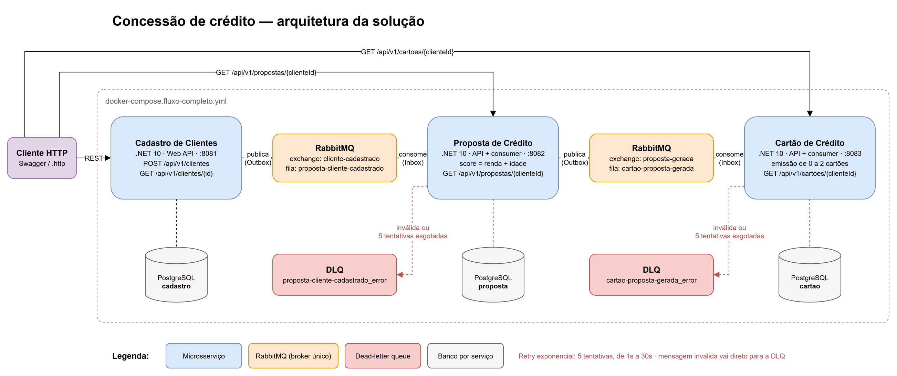

# Proposta de Crédito

Microsserviço que **consome o evento `ClienteCadastrado`**, **calcula o score de crédito**, gera a proposta e **publica `PropostaGerada`** para o serviço de Cartão de Crédito.

```
Cadastro de Clientes ──ClienteCadastrado──▶ Proposta de Crédito ──PropostaGerada──▶ Cartão de Crédito
```



O [fluxo detalhado](docs/fluxo-detalhado.png) mostra as decisões de cada serviço: validações, idempotência, retry e DLQ. Para editar os diagramas, abra a fonte no draw.io: [docs/fluxograma.drawio](docs/fluxograma.drawio).

## Stack

| | |
|---|---|
| Plataforma | .NET 10 (ASP.NET Core Web API + consumer MassTransit no mesmo processo) |
| Banco | PostgreSQL 17 + EF Core 10 (migrations, `snake_case`) |
| Mensageria | RabbitMQ 4.1 + MassTransit 8: retry exponencial, dead-letter queue, Inbox e Outbox |
| Testes | xUnit |
| Documentação da API | OpenAPI + Swagger UI |

## Como executar

### Fluxo completo (recomendado)

O RabbitMQ precisa ser o mesmo para os três serviços. Com os repositórios clonados **lado a lado na mesma pasta**, rode a partir do `cadastro-clientes-service`:

```bash
docker compose -f docker-compose.fluxo-completo.yml up -d --build
```

| Recurso | Endereço |
|---|---|
| Swagger da Proposta | http://localhost:8082/swagger |
| Swagger do Cadastro | http://localhost:8081/swagger |
| Painel do RabbitMQ | http://localhost:15672 (guest / guest) |

Cadastre um cliente pelo Swagger do Cadastro e consulte a proposta com o `id` devolvido: `GET http://localhost:8082/api/v1/propostas/{clienteId}`.

### Só este serviço

```bash
docker compose up -d --build
```

Sobe a API (porta 8082), o PostgreSQL e um RabbitMQ próprio. Útil para desenvolver isoladamente; sem o Cadastro, as mensagens podem ser publicadas pelo painel do RabbitMQ.

Para rodar a API fora do Docker (porta 5139):

```bash
docker compose up -d proposta-postgres rabbitmq
dotnet run --project src/PropostaCredito.Api
```

### Testes

```bash
dotnet test
```

## Endpoint

| Método | Rota | Descrição | Respostas |
|---|---|---|---|
| `GET` | `/api/v1/propostas/{clienteId}` | Consulta a proposta do cliente | `200` · `404` |

A proposta é gerada de forma **assíncrona** após o cadastro. Logo depois de cadastrar, a consulta pode responder `404` por alguns instantes (consistência eventual).

```json
{
  "id": "1b4df6d0-d79a-4e81-b0b7-67247bfa6fe6",
  "clienteId": "227f8869-4cd1-4c81-b311-b334b778841a",
  "nomeCliente": "Maria Silva",
  "score": 800,
  "status": "Aprovada",
  "quantidadeCartoes": 2,
  "limitePorCartao": 5000.00,
  "limiteTotal": 10000.00,
  "criadaEm": "2026-10-29T14:26:02.89614Z"
}
```

## Regra de score

O desafio define as faixas de score, mas **não define como calculá-lo**; o modelo real de um banco é proprietário. A regra adotada é uma simplificação inspirada no crédito consignado, em que renda e estabilidade são os principais fatores:

**Score = pontos de renda + pontos de idade** (máximo 1000)

| Renda mensal | Pontos |
|---|---|
| até R$ 1.499,99 | 50 |
| R$ 1.500,00 – R$ 2.999,99 | 200 |
| R$ 3.000,00 – R$ 4.999,99 | 350 |
| R$ 5.000,00 – R$ 9.999,99 | 500 |
| a partir de R$ 10.000,00 | 700 |

| Idade | Pontos |
|---|---|
| 18 – 24 anos | 50 |
| 25 – 60 anos | 300 |
| acima de 60 anos | 150 |

### Política de crédito (tabela do desafio)

| Score | Status | Cartões | Limite por cartão |
|---|---|---|---|
| 0 – 100 | Negada | 0 | — |
| 101 – 500 | Aprovada | 1 | R$ 1.000,00 |
| 501 – 1000 | Aprovada | 2 | R$ 5.000,00 |

Na faixa 501–1000 o desafio fala em "até 2" cartões, sem critério para escolher entre 1 e 2. A interpretação adotada é emitir o máximo da faixa.

| Exemplo | Score | Resultado |
|---|---|---|
| R$ 1.000, 20 anos | 50 + 50 = **100** | Negada |
| R$ 2.000, 36 anos | 200 + 300 = **500** | 1 cartão de R$ 1.000 |
| R$ 5.000, 36 anos | 500 + 300 = **800** | 2 cartões de R$ 5.000 |

## Mensageria

| | Evento | Exchange | Fila |
|---|---|---|---|
| Consome | `ClienteCadastrado` | `cliente-cadastrado` | `proposta-cliente-cadastrado` |
| Publica | `PropostaGerada` | `proposta-gerada` | — |

**`PropostaGerada`** é publicada para **toda** proposta, aprovada ou negada. Quem decide se há cartão a emitir é o consumidor, pelo `status` e pela `quantidadeCartoes`.

```json
{
  "propostaId": "1b4df6d0-d79a-4e81-b0b7-67247bfa6fe6",
  "clienteId": "227f8869-4cd1-4c81-b311-b334b778841a",
  "nomeCliente": "Maria Silva",
  "score": 800,
  "status": "Aprovada",
  "quantidadeCartoes": 2,
  "limitePorCartao": "5000.00",
  "geradaEm": "2026-10-29T14:26:02.89614Z"
}
```

O MassTransit serializa `decimal` como string para não perder precisão; consumidores MassTransit desserializam de volta para `decimal`.

## Resiliência

| Mecanismo | O que resolve |
|---|---|
| **Retry exponencial** (5 tentativas, de 1s até 30s) | falhas transitórias, como o banco fora do ar por alguns segundos |
| **Dead-letter queue** (`proposta-cliente-cadastrado_error`) | esgotadas as tentativas, a mensagem não se perde: fica na DLQ com o motivo da falha nos headers, pronta para reprocessamento |
| **Mensagem inválida sem retry** | dados que nunca vão funcionar (ex.: renda zerada) vão direto para a DLQ, sem gastar tentativas |
| **Inbox** | a mesma mensagem entregue duas vezes é processada uma vez só |
| **Idempotência de negócio** + índice único em `cliente_id` | o mesmo cliente nunca recebe duas propostas, mesmo que o evento seja republicado |
| **Outbox** | `PropostaGerada` só é publicada se a proposta for gravada, e não se perde se o RabbitMQ cair |

Todos os cenários foram verificados com o fluxo rodando: o banco derrubado durante o processamento (a proposta foi gerada após as retentativas), a mensagem com renda zero (foi para a DLQ na primeira tentativa) e o evento republicado (ignorado, sem proposta duplicada).

## Variáveis de ambiente

| Variável | Descrição | Exemplo |
|---|---|---|
| `ConnectionStrings__PropostaDb` | Conexão com o PostgreSQL | `Host=proposta-postgres;Port=5432;Database=proposta;Username=postgres;Password=postgres` |
| `RabbitMq__Host` | Host do RabbitMQ | `rabbitmq` |
| `RabbitMq__Port` | Porta AMQP (padrão `5672`) | `5672` |
| `RabbitMq__VirtualHost` | Virtual host (padrão `/`) | `/` |
| `RabbitMq__Username` | Usuário | `guest` |
| `RabbitMq__Password` | Senha | `guest` |
| `Database__ApplyMigrationsOnStartup` | Aplica as migrations ao subir (ligado em `Development`) | `true` |
| `ASPNETCORE_ENVIRONMENT` | `Development` habilita Swagger e migrations automáticas | `Development` |

A aplicação **não sobe** se a connection string ou as credenciais do RabbitMQ estiverem ausentes (fail-fast).

## Estrutura

```
src/
├── PropostaCredito.Api              → Controller, tratamento de erros, Program.cs
├── PropostaCredito.Application      → Caso de uso (PropostaService), DTOs, contratos dos eventos
├── PropostaCredito.Domain           → Score (IScoreCalculator), política de crédito, entidade Proposta
└── PropostaCredito.Infrastructure   → EF Core, repositório, consumer + retry/DLQ, migrations
tests/
└── PropostaCredito.UnitTests        → xUnit, espelhando a estrutura de src/
```

O **consumer** é um adaptador fino: recebe a mensagem e chama o `PropostaService`, que contém o caso de uso. A regra de score e a política de crédito ficam no **Domain**, sem nenhuma dependência, e são testadas isoladamente.

## Decisões técnicas

**Score como Strategy (`IScoreCalculator`).** O cálculo é o ponto do sistema que mais tende a mudar (ex.: consultar um bureau como Serasa). Trocar a regra é registrar outra implementação, sem mexer no caso de uso.

**Score e política separados.** Calcular o score e decidir o crédito a partir dele são regras diferentes, que mudam por motivos diferentes. A política espelha exatamente a tabela do desafio.

**Data de referência injetada.** A idade é calculada a partir do `TimeProvider`, o que torna testáveis as fronteiras de faixa etária.

**`PropostaGerada` para aprovadas e negadas.** O evento registra a decisão; quem decide emitir cartão é o serviço de Cartão. Isso mantém a responsabilidade de emissão num lugar só.

**Status como texto.** No banco e no evento o status é `"Aprovada"`/`"Negada"`: legível em consultas e sem depender de um enum compartilhado entre serviços.

**Contratos sem biblioteca compartilhada.** Cada serviço mantém sua cópia dos eventos, identificados pela URN (`cliente-cadastrado`, `proposta-gerada`), e não pelo namespace C#. Isso permite deploys independentes.

**Minimização de dados (LGPD).** Este serviço não recebe nem armazena CPF ou e-mail: apenas o necessário para a análise de crédito.

**MassTransit 8.x.** A partir da versão 9 o MassTransit passou a exigir licença comercial; a 8.x segue open source (Apache 2.0).
